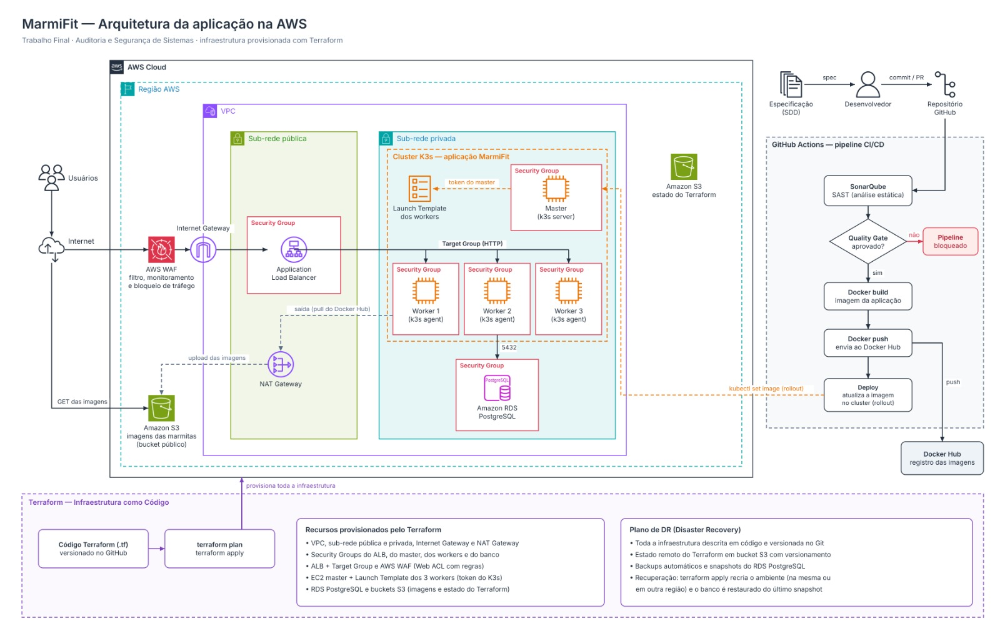

# 🥗 MarmiFit

Plataforma que conecta **restaurantes de marmitas fitness** a **clientes** que querem comer bem sem cozinhar.
O cliente escolhe um restaurante, vê o catálogo, faz o pedido e **retira no local** — o pagamento é feito na retirada.

> Trabalho de **Auditoria e Segurança de Sistemas** (UNIDAVI — Prof. Fabiano Gabardo Lemos), atividade da Aula 7 (SSDLC):
> sistema simples desenvolvido com **SDD**, em Docker, com pipeline **GitHub Actions** e scanner de segurança (**SonarQube**) no processo de deploy, implantado na **AWS** com **Terraform** (VPC segmentada, cluster **K3s**, RDS PostgreSQL, S3, ALB + WAF).
> A ideia de negócio vem do trabalho de Empreendedorismo & Inovação (MarmiFit).

> 📑 **Apresentação e documentação do trabalho:** [slides (PowerPoint)](docs/apresentacao/MarmiFit-apresentacao.pptx) · [documento técnico (PDF)](docs/apresentacao/MarmiFit-documentacao.pdf)

## Sumário
- [Perfis e funcionalidades](#perfis-e-funcionalidades)
- [Como rodar](#como-rodar)
- [SDD — como o projeto é documentado](#sdd--como-o-projeto-é-documentado)
- [Arquitetura](#arquitetura)
- [Pipeline CI/CD + SonarQube](#pipeline-cicd--sonarqube)
- [Segurança — mapa dos conteúdos da disciplina](#segurança--mapa-dos-conteúdos-da-disciplina)
- [API](#api)
- [Estrutura de pastas](#estrutura-de-pastas)

## Perfis e funcionalidades

| Perfil | O que faz |
|---|---|
| **Visitante** | Na tela inicial escolhe **"Sou cliente"** ou **"Sou empresa"** e se cadastra |
| **Cliente** | Escolhe um restaurante → vê o catálogo (filtro por categoria) → monta o pedido com horário de retirada → acompanha/cancela |
| **Restaurante** | Edita os dados da empresa → cadastra marmitas com foto, preço e informação nutricional → atende os pedidos (recebido → em preparo → pronto → retirado) |
| **Admin** | Aprova/bloqueia empresas, ativa/desativa usuários, vê todos os pedidos e marmitas |
| **Todos** | Em **Minha conta** trocam a própria senha (encerra as outras sessões abertas) |

Empresas novas ficam **pendentes** até o admin aprovar; só então aparecem para os clientes.

## Como rodar

Guia para testar a aplicação no seu computador (Windows, Linux ou macOS). Leva uns 10 minutos na primeira vez.

### 1. Instale os pré-requisitos
| Ferramenta | Onde baixar | Observação |
|---|---|---|
| **Git** | https://git-scm.com/downloads | No Windows, vem junto o **Git Bash** (use ele nos comandos abaixo) |
| **Docker Desktop** | https://www.docker.com/products/docker-desktop | No Windows, precisa do **WSL 2** (o instalador oferece). Reinicie o PC depois de instalar |

Abra o Docker Desktop e espere aparecer **"Engine running"** no canto inferior esquerdo. Não precisa instalar Node nem Postgres: tudo roda em containers.

### 2. Baixe o projeto
```bash
git clone https://github.com/1GustavoBorgonha1/aplicacao_tb_fnl_si.git marmifit
cd marmifit
```

### 3. Crie o arquivo `.env` (senhas locais)
O `.env` guarda as senhas e **nunca** vai para o Git. No **Git Bash** (Windows) ou no terminal (Linux/macOS), este comando cria o arquivo já com senhas aleatórias:
```bash
sed -e "s|^POSTGRES_PASSWORD=.*|POSTGRES_PASSWORD=$(openssl rand -hex 16)|" \
    -e "s|^JWT_SECRET=.*|JWT_SECRET=$(openssl rand -base64 48 | tr -d '\n')|" \
    .env.example > .env
```
O admin fica com o e-mail e a senha que estão no `.env` (`ADMIN_EMAIL` / `ADMIN_PASSWORD`; padrão `admin@marmifit.local` / `Admin12345`). Troque se quiser **antes** da primeira subida.

### 4. Suba a aplicação
```bash
docker compose up -d --build     # a primeira vez demora alguns minutos (baixa e compila as imagens)
docker compose ps                # db, backend e frontend devem ficar "healthy"
```

| O quê | Endereço |
|---|---|
| **Aplicação** | **http://localhost:8080** |
| Health check | http://localhost:8080/api/health → `{"status":"ok"}` |
| Login do admin | `ADMIN_EMAIL` / `ADMIN_PASSWORD` do `.env` |

O banco **não** é exposto no host (rede interna). As imagens das marmitas ficam no volume `marmifit_uploads` (o "S3 local").

### 5. Parar, ver logs e recomeçar
```bash
docker compose logs -f backend   # logs da API (eventos de auditoria têm "audit":true)
docker compose down              # para tudo, mantendo os dados
docker compose down -v           # para e APAGA banco e imagens (recomeça do zero)
```

### Problemas comuns
| Sintoma | Solução |
|---|---|
| Docker Desktop: **"WSL is unresponsive"** | PowerShell **como administrador**: `winget install --id Microsoft.WSL -e --force` e reinicie o PC |
| `port is already allocated` na 8080 | Mude `APP_PORT=8081` no `.env` e acesse http://localhost:8081 |
| `required variable ... is missing` | O `.env` não foi criado (passo 3) ou falta algum valor |
| Backend reiniciando / erro de senha do banco | A senha do banco foi trocada depois da primeira subida: `docker compose down -v` e suba de novo |
| Login do admin não funciona | O admin é criado só na primeira subida; se mudou o `.env` depois, rode `docker compose down -v` |

Quer testar também no **Kubernetes** (como na AWS)? Veja [k8s/README.md](k8s/README.md).

### Roteiro de demonstração
1. Cadastre uma empresa em **Sou empresa** e faça login → aparece o aviso "aguardando aprovação".
2. Cadastre algumas marmitas com foto em **Marmitas**.
3. Entre como **admin** → aba **Empresas** → **Aprovar**.
4. Cadastre um cliente em **Sou cliente** → escolha o restaurante → adicione marmitas → **Fazer pedido**.
5. Volte ao restaurante → **Pedidos** → avance o status até **Retirado**; o cliente acompanha em **Meus pedidos**.

### Testes
```bash
# Backend — testes de integração (API + Postgres descartável)
docker compose -f docker-compose.test.yml up --build --abort-on-container-exit --exit-code-from tests
docker compose -f docker-compose.test.yml down -v

# Frontend — testes de componentes (Vitest + Testing Library); precisa de Node 26
cd frontend && npm ci && npm test            # npm run test:coverage gera frontend/coverage/lcov.info
```
Cada teste cita o critério de aceite da spec que ele comprova (ex.: `CA-004-01 total é calculado no servidor`).

### Desenvolvimento sem Docker (opcional)
```bash
cd backend && npm install && DATABASE_URL=postgres://... JWT_SECRET=... npm run dev
cd frontend && npm install && npm run dev      # http://localhost:5173 (proxy /api → :3000)
```

## SDD — como o projeto é documentado

**Spec-Driven Development:** a especificação é escrita **antes** do código e é a fonte da verdade.

```
.specify/memory/constitution.md   princípios inegociáveis (segurança, simplicidade, pipeline)
specs/
  000-arquitetura/   visão geral, modelo de dados, ADRs (decisões)
  001-autenticacao/  spec.md → plan.md → tasks.md
  002-restaurantes/
  003-marmitas/
  004-pedidos/
  005-admin/
  006-troca-senha/
  _template/         modelo para novas funcionalidades
```

| Arquivo | Responde | Contém |
|---|---|---|
| `spec.md` | **O quê / por quê** | Histórias (HU), critérios de aceite (CA), requisitos de segurança (RS), ameaças STRIDE |
| `plan.md` | **Como** | Endpoints, validações, arquivos, dependências |
| `tasks.md` | **Passos** | Checklist rastreável da implementação |

**Rastreabilidade:** `CA-003-04` na spec → validação por *magic bytes* em `backend/src/middlewares/upload.js` → teste `"CA-003-04 rejeita arquivo que não é imagem"` em `backend/tests/meals.test.js`.

**Nova funcionalidade:** copie `specs/_template/` para `specs/006-nome/`, escreva a spec, revise, e só então implemente.

## Arquitetura



```
 navegador ──► frontend (Nginx :8080, não-root) ──► backend (Node/Express :3000, não-root) ──► Postgres
               React build + headers + rate limit     JWT + RBAC + zod + logs de auditoria      (rede interna)
                                                       └─► imagens: pasta local  →  S3 na AWS
```

| Local (Docker Compose) | AWS (ver [docs/deploy-aws.md](docs/deploy-aws.md)) |
|---|---|
| Container `frontend` | Pods do frontend no **K3s** (NodePort 30080) atrás de **ALB + WAF** |
| Container `backend` | Pods do backend no K3s (Service interno, só o frontend acessa) |
| Container `db` (Postgres 16) | **RDS PostgreSQL** (subnet privada, criptografado) |
| Volume `uploads` (`STORAGE_DRIVER=local`) | **S3** (`STORAGE_DRIVER=s3`; leitura pública só em `meals/*`) |
| Rede `back-net` (internal) | Subnet privada + Security Groups + NetworkPolicy |
| `docker compose up` | **Terraform** (infraestrutura) + `kubectl apply -k k8s/overlays/aws` |

A troca é **só por configuração** (variáveis de ambiente / ConfigMap e Secret) — o código e as imagens são os mesmos. Contrato com a infraestrutura em [infra/README.md](infra/README.md); manifests em [k8s/](k8s/). Detalhes e decisões (ADRs) em [specs/000-arquitetura/plan.md](specs/000-arquitetura/plan.md).

## Pipeline CI/CD + SonarQube

[.github/workflows/ci.yml](.github/workflows/ci.yml):

```
 push/PR ─► test (lint + testes + cobertura + build front) ─► sonarqube (Quality Gate) ─┐
        ├─► audit (npm audit --audit-level=high) ────────────────────────────────────────┼─► build (docker build + push Docker Hub) ─► deploy (kubectl set image no K3s)
        └─► infra (manifests k8s + terraform fmt/validate) ──────────────────────────────┘
```
- **SonarQube** faz SAST (vulnerabilidades, *security hotspots*, segredos no código), qualidade e cobertura do código da aplicação e dos manifests do Kubernetes. Com `sonar.qualitygate.wait=true`, **Quality Gate reprovado = pipeline vermelho = nada é publicado**. *Casos reais deste projeto:* o gate barrou um modelo de Secret com senha em YAML e a senha fixa do banco de teste do CI.
- **npm audit** barra dependências com CVE alta/crítica. *Caso real:* barrou o `zod 3` (GHSA-mrhx-c7xc-m3w5) e motivou a migração para o zod 4.
- **infra** valida os overlays do Kubernetes e, quando existir `infra/terraform/`, roda `terraform fmt -check` e `terraform validate`.
- **build** gera as imagens `gustavoborgonha/marmifit-backend` e `gustavoborgonha/marmifit-frontend` (tags `latest` e SHA do commit). Em PR só compila; o push no **Docker Hub** acontece só na `main`.
- **deploy** roda `kubectl set image` + `rollout status` no master do K3s via **AWS SSM** (o master fica na subnet privada: sem SSH e sem porta aberta), com credenciais temporárias via **GitHub OIDC** (sem access key). Só roda na `main`, com `vars.DEPLOY_ENABLED=true` e aprovação manual no environment `production`.
- **Supply chain:** actions fixadas pelo SHA do commit, `npm ci --ignore-scripts`, `permissions` mínimas do `GITHUB_TOKEN`. **Dependabot** abre PRs semanais (npm, Docker e Actions).

Secrets/variables usados: `SONAR_TOKEN`, `SONAR_HOST_URL`, `SONAR_ORGANIZATION`, `DOCKERHUB_USERNAME`, `DOCKERHUB_TOKEN` e, para o deploy, `DEPLOY_ENABLED`, `AWS_REGION`, `AWS_DEPLOY_ROLE_ARN`, `K3S_MASTER_INSTANCE_ID`.

### Configurar o SonarQube no GitHub
Os runners do GitHub não alcançam um SonarQube rodando na sua máquina; use uma das opções:

1. **SonarQube Cloud** (grátis para repositório público): entre em sonarcloud.io com o GitHub, importe o repositório, **desative a "Automatic Analysis"** (a análise vem do CI) e gere um token.
   Secrets: `SONAR_TOKEN`, `SONAR_HOST_URL=https://sonarcloud.io` · Variable: `SONAR_ORGANIZATION=<sua-org>`
2. **SonarQube próprio** numa EC2 (`docker-compose.sonar.yml`): secrets `SONAR_TOKEN` e `SONAR_HOST_URL=http://<ip>:9000`.

### SonarQube local (análise manual antes do push)
```bash
sudo sysctl -w vm.max_map_count=524288                 # exigência do Elasticsearch interno
docker compose -f docker-compose.sonar.yml up -d        # http://localhost:9000 (admin/admin → troque a senha)
# Crie o projeto "marmifit" e um token em My Account → Security. Depois:
(cd backend && npm run test:coverage)                   # gera backend/coverage/lcov.info
docker run --rm --network host -e SONAR_HOST_URL=http://localhost:9000 -e SONAR_TOKEN=<token> \
  -v "$PWD:/usr/src" sonarsource/sonar-scanner-cli
```

## Segurança — mapa dos conteúdos da disciplina

| Aula | Conteúdo | Onde está no projeto |
|---|---|---|
| 1–2 | Tríade CID, políticas, ISO 27001, LGPD | [docs/seguranca/politica-seguranca.md](docs/seguranca/politica-seguranca.md) |
| 3 | Criptografia (hash, simétrica, assimétrica) | [docs/seguranca/criptografia.md](docs/seguranca/criptografia.md) — bcrypt, JWT HS256, TLS, AES-256 no RDS/S3 |
| 4 | DoS / Slowloris / ModSecurity / mod_qos | `frontend/nginx.conf` (timeouts, `limit_req`), WAF na AWS |
| 7 | **SSDLC** | SDD (`specs/`), requisitos de segurança em cada spec, testes, SonarQube no pipeline |
| 8 | OWASP Top 10 | [docs/seguranca/owasp-mitigacoes.md](docs/seguranca/owasp-mitigacoes.md) — controle × arquivo × teste |
| 9 | Gestão de riscos, matriz P×I | [docs/seguranca/matriz-riscos.md](docs/seguranca/matriz-riscos.md) |
| 10 | Hardening, mínimo privilégio, CIS | [docs/seguranca/hardening.md](docs/seguranca/hardening.md) — containers não-root, `read_only`, `cap_drop`, Pod Security `restricted`, NetworkPolicy |
| 11 | PCN, resposta a incidentes, DR, CI/CD | [docs/continuidade/pcn-pri-dr.md](docs/continuidade/pcn-pri-dr.md) |
| 12 | Nuvem: subnets pública/privada, LB, WAF, IaC | [docs/deploy-aws.md](docs/deploy-aws.md), [infra/README.md](infra/README.md), [k8s/](k8s/) |

## API

Base `/api`, JSON, `Authorization: Bearer <token>`. Erros: `{ "erro": "...", "detalhes"?: {...} }`.

| Método | Rota | Perfil |
|---|---|---|
| POST | `/auth/register/cliente` · `/auth/register/restaurante` · `/auth/login` | público |
| GET | `/auth/me` · PATCH `/auth/senha` | autenticado |
| GET | `/restaurants` · `/restaurants/:id` · `/restaurants/:id/meals?categoria=` | público |
| GET/PUT | `/restaurants/me` | restaurante |
| GET | `/meals/mine` · POST `/meals` · PUT/DELETE `/meals/:id` | restaurante |
| POST | `/orders` · GET `/orders/mine` · PATCH `/orders/:id/cancel` | cliente |
| GET | `/orders/received?status=` · PATCH `/orders/:id/status` | restaurante |
| GET | `/admin/stats` · `/admin/restaurants` · `/admin/users` · `/admin/orders` · `/admin/meals` | admin |
| PATCH | `/admin/restaurants/:id/status` · `/admin/users/:id/ativo` · `/admin/meals/:id` | admin |

Detalhes de cada rota no `plan.md` da spec correspondente.

## Estrutura de pastas
```
backend/        API Node/Express (src/routes, middlewares, services, storage, db) + migrations + tests
frontend/       React + Vite + nginx.conf
specs/          SDD — specs, planos e tarefas
docs/           segurança, continuidade, deploy AWS e diagrama da arquitetura
k8s/            manifests Kubernetes (Kustomize): base + overlays local e aws
infra/          terraform/ (infraestrutura AWS) e database/ (schema e requisitos do RDS)
.github/        pipeline CI/CD e Dependabot
docker-compose.yml        ambiente local
docker-compose.test.yml   testes de integração
docker-compose.sonar.yml  SonarQube local
```
